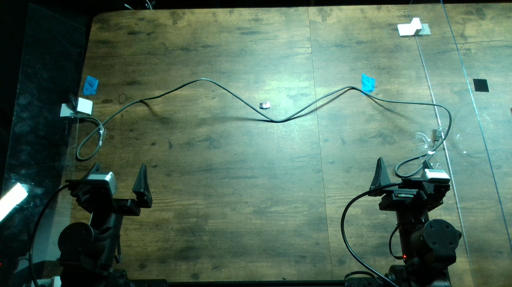

# Press the cable into the clip

Task `datacenterbench/clip`, version 1, from release 1.0.0.

## Instruction

What the model is told, word for word:

> Press the black network cable into the dark clip on the table, so the cable is held by the clip.

## Setup

Black cord clip stuck to the table; black Ethernet cable laid in a gentle wave passing just in front of the clip, ends routed away from the arms, same path every trial.

Between trials: Pull the cable out of the clip and lay it back along its path in front of the clip.

Wrist cameras at the start: [left](../assets/clip-setup-left.jpg), [right](../assets/clip-setup-right.jpg).

## Equipment

| Object | Quantity | Product | As used |
|---|--:|---|---|
| Command clear cord clips, 13 clips and 16 strips | 1 | [link](https://www.amazon.com/dp/B076ZT3FVN) | Command cord clip, darkened, stuck to the table |
| Black Ethernet cable | 1 | on hand |  |

The board and mounting supplies are on [Shared equipment](../equipment.md).

## Rubric

A trial scores one of these levels. The judges see the task name, the guidance and every level
below, word for word.

| Score | End state |
|--:|---|
| 1 | The cable is seated inside the clip. |
| 0 | The cable is not inside the clip (for example lying next to it). |

## The real-world step

Route cables through a switch tray: Route the cables through the switch tray's routing channel before closing it.

> Route the cables through the routing channel.

Source: [Dell PowerSwitch Tray-21 installation guide](https://www.dell.com/support/manuals/en-ge/networking-s3248t-on/powerswitch_tray-21_install_pub/powerswitch-tray-21-installation-for-the-s5232f-on?guid=guid-41724a60-13ae-4d08-bd3e-35c577d2e2e7&lang=en-us). We seat one cable in one small clip. The real procedure routes cables through a channel, with different geometry and access constraints.
