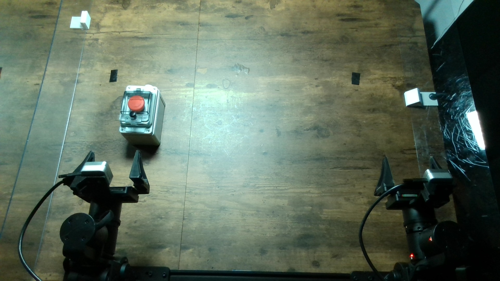

# Open the spring-loaded cover

Task `datacenterbench/cover`, version 1, from release 1.0.0.

## Instruction

What the model is told, word for word:

> Lift the clear cover on the grey box all the way open, until it stays open on its own. It is spring-loaded and snaps shut if it is not pushed far enough.

## Setup



E-stop box fixed to the board in front of the left arm; clear cover closed, red button released (pulled up), the same every trial.

Between trials: Close the clear cover. Check the red button is released (pulled up), not latched down.

Wrist cameras at the start: [left](../assets/cover-setup-left.jpg), [right](../assets/cover-setup-right.jpg).

## Equipment

| Object | Quantity | Product | As used |
|---|--:|---|---|
| GUETNEU emergency-stop button with cover, IP67 switch box | 1 | [link](https://www.amazon.com/dp/B0CR19ZTBJ) | GUETNEU covered emergency-stop button box |

The board and mounting supplies are on [Shared equipment](../equipment.md).

## Rubric

A trial scores one of these levels. The judges see the task name, the guidance and every level
below, word for word.

```text
The clear cover is hinged at the back. Closed, it lies flat over the red button. Open, it stands up behind the button on its own. The overhead and left wrist cameras both show it. The end photos are taken with the arms parked, so a cover only held up by the gripper will have snapped shut.
```

| Score | End state |
|--:|---|
| 1 | The cover is open and staying open on its own. |
| 0 | The cover is closed. |

## The real-world step

Access an emergency power-off button: In an emergency, rotate the clear protective cover and push the Emergency Power Off switch on the power distribution unit's panel.

> rotate the clear protective cover and push the Emergency Power Off (EPO) switch

Source: [Vertiv Liebert FPC user manual](https://www.vertiv.cn/globalassets/products/critical-power/power-distribution/liebert-fpc-15-300kva-with-vpmp-user-manual_00.pdf), §4.1.1. We score opening the cover until it stays open. Pressing the button and shutting down equipment are outside this task.
