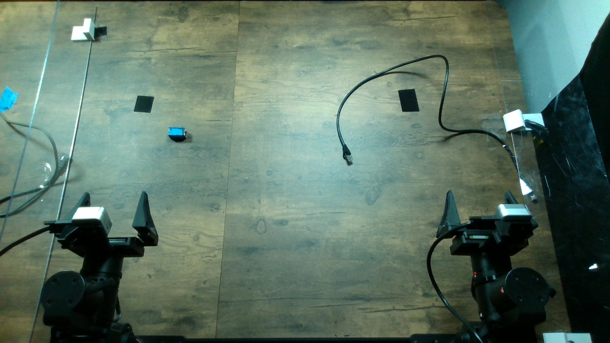

# Join the Ethernet plug and coupler

Task `datacenterbench/join`, version 1, from release 1.0.0.

## Instruction

What the model is told, word for word:

> Use one hand to hold the Ethernet coupler and the other to insert the Ethernet plug into it until it clicks into place.

## Setup

Ethernet cable and a loose Ethernet coupler on the board, same spots every trial.

Between trials: Pull the plug out of the coupler and put both back in their spots.

Wrist cameras at the start: [left](../assets/join-setup-left.jpg), [right](../assets/join-setup-right.jpg).

## Equipment

| Object | Quantity | Product | As used |
|---|--:|---|---|
| Amazon Basics Cat 6 Ethernet patch cable, 3 ft, black | 1 | [link](https://www.amazon.com/dp/B089MGH8T5) | Amazon Basics 3 ft Cat6 cable |
| EZYUMM RJ45 Ethernet coupler, female to female, 3-pack | 1 | [link](https://www.amazon.com/dp/B0D5ZHG8JX) | EZYUMM Ethernet coupler |

The board and mounting supplies are on [Shared equipment](../equipment.md).

## Rubric

A trial scores one of these levels. The judges see the task name, the guidance and every level
below, word for word.

| Score | End state |
|--:|---|
| 1 | The Ethernet plug is fully inserted into the coupler, no gap. |
| 0 | The plug is not fully inserted in the coupler. |

## The real-world step

Mate equipment connectors: Connect the UPS and distribution-box cable connectors together and make sure they are fully mated.

> connect the UPS and distribution box connectors together. Ensure that the connectors are fully connected.

Source: [Vertiv Liebert GXT5 UPS installer/user guide](https://www.vertiv.com/4a3d0a/globalassets/shared/liebert-gxt5-installer-user-guide-120-208v-input-l1-l2-n-g-120-208v-output-mv-sl-70524.pdf), §3.6.2, p. 22. Our task uses an Ethernet plug and loose coupler, one in each gripper. The cited UPS uses different connectors and does not specify a two-handed grip.
