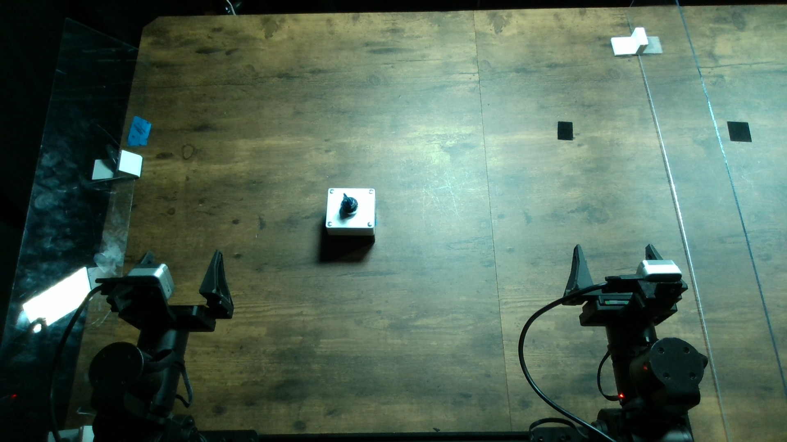

# Turn the key

Task `datacenterbench/key`, version 1, from release 1.0.0.

## Instruction

What the model is told, word for word:

> Turn the key clockwise to its other position. Leave it there and release it.

## Setup



Key switch in its white box, fixed to the board; key in its start position, the same every trial.

Between trials: Turn the key back to its start position.

Wrist cameras at the start: [left](../assets/key-setup-left.jpg), [right](../assets/key-setup-right.jpg).

## Equipment

| Object | Quantity | Product | As used |
|---|--:|---|---|
| APIELE 22 mm two-position key switch, XB2-10Y/21 (maintained) | 1 | [link](https://www.amazon.com/dp/B088PRMK7R) |  |
| uxcell push-button control station box, 22 mm, one hole | 1 | [link](https://www.amazon.com/dp/B07WQQQGFX) | uxcell one-hole 22 mm enclosure |

The board and mounting supplies are on [Shared equipment](../equipment.md).

## Rubric

A trial scores one of these levels. The judges see the task name, the guidance and every level
below, word for word.

```text
The top camera looks down on the key's head: compare its angle in the start and end photos. The instruction also asks the robot to let go of the key.
```

| Score | End state |
|--:|---|
| 1 | The key is turned clockwise to its other position and left there, with the gripper released. |
| 0.5 | The key is turned to its other position but the gripper is still holding it. |
| 0 | The key is in its start position (or turned the other way). |

## The real-world step

Release a breaker interlock: Release the key interlock on the maintenance bypass breaker before switching it.

> Insert the Key into the lock on the MBB and turn the Key.

Source: [Vertiv Liebert EXM UPS user manual (SL-26100 Rev 12)](https://www.vertiv.com/4a0511/globalassets/shared/liebert-exm-20-200kva-ups-um-en-na-sl-26100_rev-12-lt.pdf), §7.6, p. 53. Our key starts in a panel switch. We test turning it, without inserting the key or operating the associated breaker.
