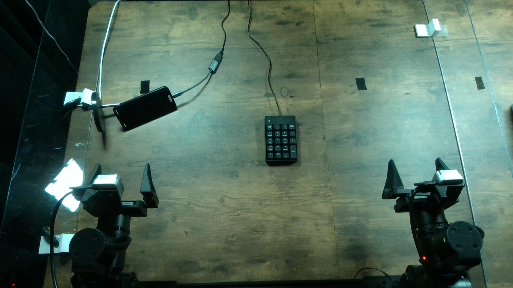

# Enter a code on the keypad

Task `datacenterbench/keypad`, version 1, from release 1.0.0.

## Instruction

What the model is told, word for word:

> Type 52 on the number pad and nothing else. The iPhone next to it shows what you type.

## Setup



USB number pad and the iPhone display on the board, the phone on a MagSafe stand; starting a trial clears the display.

Between trials: None by hand: starting a trial clears the display. Before each automatic start, the rig software checks the scene against a reference photo, that the motors have cooled, and that the phone shows a test word (READY).

Wrist cameras at the start: [left](../assets/keypad-setup-left.jpg), [right](../assets/keypad-setup-right.jpg).

## Equipment

| Object | Quantity | Product | As used |
|---|--:|---|---|
| TechGarden wired USB number pad, 19 keys, black | 1 | [link](https://www.amazon.com/dp/B0BNPVMQVT) |  |
| iPhone on a MagSafe charging stand, showing the keypad page | 1 | on hand |  |

The board and mounting supplies are on [Shared equipment](../equipment.md).

## Rubric

A trial scores one of these levels. The judges see the task name, the guidance and every level
below, word for word.

```text
The iPhone next to the number pad shows what was typed. One keypress away means one character missing, one extra, or one wrong (for example 5, 582 or 53). The trial is scored from the display's own log; the judges cross-check it.
```

| Score | End state |
|--:|---|
| 1 | The display reads exactly 52. |
| 0.5 | The display is one keypress away from 52: one character missing, one extra, or one wrong. |
| 0 | The display shows anything else, or nothing. |

This task is scored from the keypad display's own key log, which only Robocurve's setup records. The judges' answer is a cross-check, and with this package a person reads the display and scores the trial.

## The real-world step

Log in on a UPS control panel: Log in on a UPS's hand-held control panel by pressing its physical keys: CLEAR, PROGRAM, the password digits, then ENTER.

> To enter the user-level password, follow these steps: [CLEAR] [PROGRAM] [3] [7] [7] [ENTER]

Source: [Eaton FERRUPS FE/QFE UPS user's guide (164201404 Rev C)](https://www.eaton.com/content/dam/eaton/products/backup-power-ups-surge-it-power-distribution/backup-power-ups/eaton-ferrups-tower-ups/eaton-ferrups-FE-QFE-userguide-.pdf), Entering Passwords, p. 30. We use a two-digit code on a USB number pad, with an iPhone display. The real panel requires a longer key sequence.
