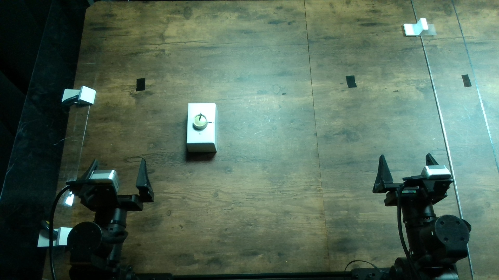

# Turn the knob to the mark

Task `datacenterbench/knob`, version 1, from release 1.0.0.

## Instruction

What the model is told, word for word:

> Turn the round knob on the white box clockwise until the black line on it points at the black mark on the box.

## Setup



Rotary dimmer in a surface backbox, fixed to the board. A black line is drawn on the knob like a clock hand. One black mark on the box at the start position and one at the goal (fully clockwise). The knob starts at the start mark every trial.

Between trials: Turn the knob back counterclockwise until its line points at the start mark.

Wrist cameras at the start: [left](../assets/knob-setup-left.jpg), [right](../assets/knob-setup-right.jpg).

## Equipment

| Object | Quantity | Product | As used |
|---|--:|---|---|
| Leviton Trimatron rotary dimmer, RNL06-10Z, white | 1 | [link](https://www.amazon.com/dp/B073H9Y7SH) | Black line drawn on the knob; start and goal marks drawn on the box. |
| Leviton surface-mount backbox, single gang, 42777-1WA, white | 1 | [link](https://www.amazon.com/dp/B0028CIC8U) |  |

The board and mounting supplies are on [Shared equipment](../equipment.md).

## Rubric

A trial scores one of these levels. The judges see the task name, the guidance and every level
below, word for word.

```text
The knob carries a black line like a clock hand. Compare where it points with the start photos and with the marks on the box.
```

| Score | End state |
|--:|---|
| 1 | The line on the knob points at the goal mark (turned clockwise to it). |
| 0.5 | The knob turned clockwise noticeably but the line stops short of the goal mark. |
| 0 | The knob did not turn clockwise (unchanged, or turned the other way). |

## The real-world step

Set a UPS bypass selector: Turn a rack-mount maintenance bypass rotary switch from UPS to MAINS, after checking the MAINS lamp is lit.

> Transfer the rotary switch from UPS to MAINS, provided the MAINS lamp is illuminated

Source: [Vertiv Liebert MicroPOD installer/user guide](https://www.vertiv.com/49ecbb/globalassets/products/critical-power/uninterruptible-power-supplies-ups/liebert-micropod-maintenance-bypass-and-output-distribution-accessory2/liebert-micropod-230v-user-guide.pdf), §6.1, p. 11. Our dimmer turns between drawn marks. The real selector has fixed positions and requires checking an indicator before switching.
