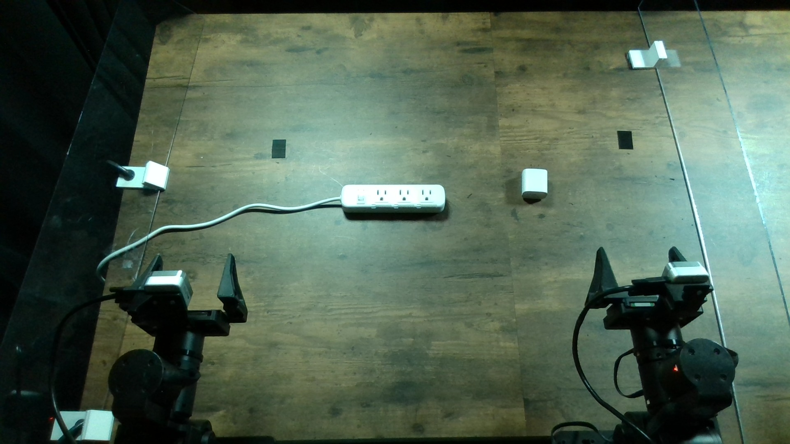

# Plug the charger into the power strip

Task `datacenterbench/plug`, version 1, from release 1.0.0.

## Instruction

What the model is told, word for word:

> Pick up the white phone charger and plug it into one of the outlets on the white power strip. Push it in until the prongs are fully inserted.

## Setup



Power strip fixed to the board, outlets up. White phone charger standing loose next to it, same spot and orientation every trial.

Between trials: Pull the charger out and stand it back in its spot, same orientation.

Wrist cameras at the start: [left](../assets/plug-setup-left.jpg), [right](../assets/plug-setup-right.jpg).

## Equipment

| Object | Quantity | Product | As used |
|---|--:|---|---|
| White phone charger and white power strip (on hand, not part of the bench order) | 1 | on hand |  |

The board and mounting supplies are on [Shared equipment](../equipment.md).

## Rubric

A trial scores one of these levels. The judges see the task name, the guidance and every level
below, word for word.

```text
Fully seated means no metal of the prongs is visible between the charger and the strip.
```

| Score | End state |
|--:|---|
| 1 | The charger is fully plugged into an outlet: flush against the strip, no prong metal visible. |
| 0.5 | The charger is in an outlet and stays there, but not fully: a visible gap or tilt. |
| 0 | The charger is not in an outlet. |

## The real-world step

Reconnect server power: Reconnect the power cord to a newly installed server power supply and secure it with the strap.

> Connect the power cable to the PSU, and plug the cable into a power outlet.

Source: [Dell EMC PowerEdge R440 installation and service manual (Rev. A11)](https://dl.dell.com/topicspdf/poweredge-r440_owners-manual9_en-us.pdf), Installing a power supply unit, p. 100. We insert a phone charger into a power strip. The real procedure connects a flexible power cord to the supply and a power outlet.
