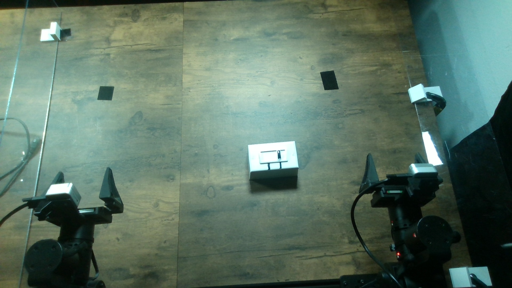

# Move the slider to the other line

Task `datacenterbench/slider`, version 1, from release 1.0.0.

## Instruction

What the model is told, word for word:

> Move the small slider on the white dimmer from the black line it is on to the other black line.

## Setup



Slide dimmer in its box, fixed to the board. Two black lines on the plate mark the start and the end of the move (short of the hard end stop, which needs extra force). Slider on the start line every trial; large rocker switch unchanged.

Between trials: Slide the slider back to the start line. Leave the large rocker switch as it is.

Wrist cameras at the start: [left](../assets/slider-setup-left.jpg), [right](../assets/slider-setup-right.jpg).

## Equipment

| Object | Quantity | Product | As used |
|---|--:|---|---|
| Leviton SureSlide dimmer, 6672-1LW, white | 1 | [link](https://www.amazon.com/dp/B00CF4IPGK) |  |
| Leviton 1-gang Decora wallplate, 122-80401-NW, white | 1 | [link](https://www.amazon.com/dp/B000HEHCE6) | Leviton Decora wallplate |
| Leviton surface-mount backbox, single gang, 42777-1WA, white | 1 | [link](https://www.amazon.com/dp/B0028CIC8U) | Leviton single-gang surface backbox |

The board and mounting supplies are on [Shared equipment](../equipment.md).

## Rubric

A trial scores one of these levels. The judges see the task name, the guidance and every level
below, word for word.

```text
The slider is the small dark control on the white dimmer; two black lines on the plate mark where it starts and where it should end. Compare its position with the start photos.
```

| Score | End state |
|--:|---|
| 1 | The slider reached the other black line (at it or past it). |
| 0.5 | The slider moved noticeably toward the other line but stopped short of it. |
| 0 | The slider did not move toward the other line, or the large rocker switch was changed. |

## The real-world step

Select a UPS operating mode: During a UPS restart, slide the mode selector left to engage static bypass, then back right to UPS.

> Use the slide switch to set the UPS to Static Bypass. Slide the switch to the left to engage Static Bypass.

Source: [Liebert UPStation S3 user manual (discontinued model)](https://www.vertiv.com/globalassets/products/critical-power/uninterruptible-power-supplies-ups/discontinued---liebert-upstation-s3/liebert-upstation-s3-user-manual.pdf), §3.2.4, p. 44. Our dimmer slides between drawn marks. The cited UPS has a two-position mode selector and is a discontinued model.
