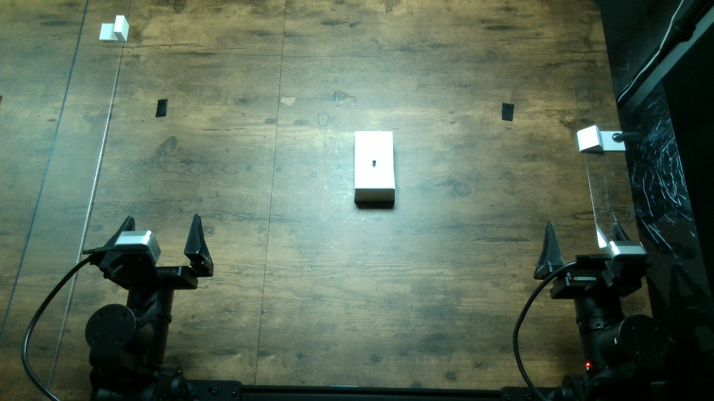

# Flip the light switch

Task `datacenterbench/toggle`, version 1, from release 1.0.0.

## Instruction

What the model is told, word for word:

> Flip the lever of the light switch on the white box to the other side.

## Setup



Wall toggle switch in its box, fixed to the board; tip of the lever colored black. Lever on the same side every trial.

Between trials: Flip the lever back to its start side.

Wrist cameras at the start: [left](../assets/toggle-setup-left.jpg), [right](../assets/toggle-setup-right.jpg).

## Equipment

| Object | Quantity | Product | As used |
|---|--:|---|---|
| Leviton 15 A toggle switch, single pole, 1451-2W, white | 1 | [link](https://www.amazon.com/dp/B00002NAR0) | Leviton toggle switch |
| Leviton surface-mount backbox, single gang, 42777-1WA, white | 1 | [link](https://www.amazon.com/dp/B0028CIC8U) | Leviton single-gang surface backbox |

The board and mounting supplies are on [Shared equipment](../equipment.md).

## Rubric

A trial scores one of these levels. The judges see the task name, the guidance and every level
below, word for word.

```text
The lever tip is colored black. Compare which side of its slot it points to in the start and end photos.
```

| Score | End state |
|--:|---|
| 1 | The lever is on the other side of its slot compared with the start. |
| 0 | The lever is on the same side as at the start. |

## The real-world step

Operate UPS bypass breakers: Move a UPS to maintenance bypass: close the bypass breaker, then open the input breaker, in the order the manual gives.

> 8. Close the MBB. … 10. Open the MIB.

Source: [Vertiv Liebert EXM UPS user manual (SL-26100 Rev 12)](https://www.vertiv.com/4a0511/globalassets/shared/liebert-exm-20-200kva-ups-um-en-na-sl-26100_rev-12-lt.pdf), §7.6, p. 53. Our wall switch tests moving a lever between two positions. It omits the breaker mechanism, electrical checks and switching sequence.
