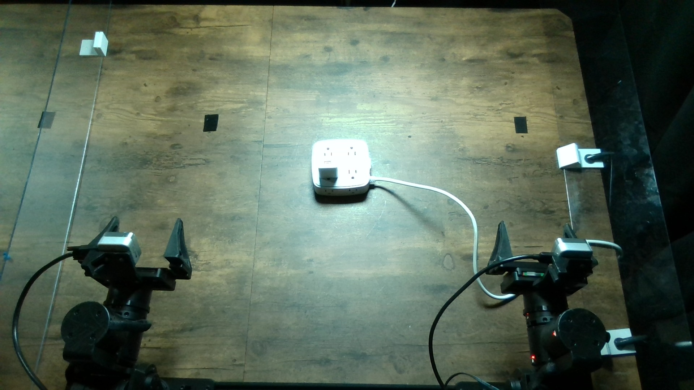

# Unplug the charger from the power strip

Task `datacenterbench/unplug`, version 1, from release 1.0.0.

## Instruction

What the model is told, word for word:

> Unplug the white phone charger from the white power strip.

## Setup

Power strip fixed to the board. White phone charger fully plugged into the same outlet every trial.

Between trials: Push the charger fully back into the same outlet.

Wrist cameras at the start: [left](../assets/unplug-setup-left.jpg), [right](../assets/unplug-setup-right.jpg).

## Equipment

| Object | Quantity | Product | As used |
|---|--:|---|---|
| White phone charger and white power strip (on hand, not part of the bench order) | 1 | on hand |  |

The board and mounting supplies are on [Shared equipment](../equipment.md).

## Rubric

A trial scores one of these levels. The judges see the task name, the guidance and every level
below, word for word.

| Score | End state |
|--:|---|
| 1 | The charger is completely out of the power strip, resting on the board or table. |
| 0 | The charger is still in an outlet, even if loosened. |

## The real-world step

Disconnect server power: Disconnect the power cable from the power supply, then press the release latch and slide the unit out.

> Disconnect the power cable from the power source and from the PSU you intend to remove.

Source: [Dell EMC PowerEdge R440 installation and service manual (Rev. A11)](https://dl.dell.com/topicspdf/poweredge-r440_owners-manual9_en-us.pdf), Removing a power supply unit, p. 99. We remove a phone charger from a power strip. The real procedure disconnects a flexible power cord at the source and the server supply.
